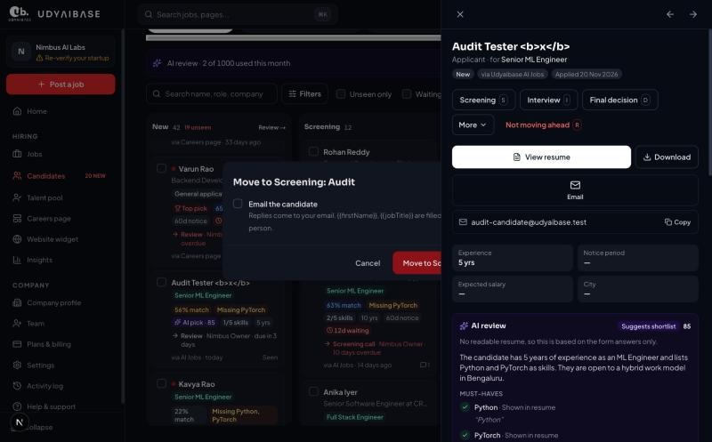

# Employer Portal and AI Jobs: Test and Audit Report

Date: 20 November 2026 · Branch: `feat/employer-hiring-steps` at `9caacf5`, including 133 uncommitted files

This report lists open security gaps. Keep it out of any public repository or shared channel until the High and Medium items are fixed.

## 1. Summary

The hiring product is in better shape than most at this stage. Tenant isolation, role permissions, CSRF, code sign-in limits and input escaping all held up under live testing. All 1,007 unit tests pass.

The problems worth fixing first:

| # | Area | Finding | Severity |
|---|------|---------|----------|
| 1 | Security | Reactivating a deactivated workspace needs only a password: no two-step check, no captcha, no lockout | High |
| 2 | UX bug | The "Move candidate" dialog opens behind the candidate panel, so moving a candidate looks broken | High |
| 3 | UX | "New" and "waiting" counts disagree across dashboard, board, jobs and insights | High |
| 4 | UX / trust | Verification state contradicts itself: live jobs, a public "Verified Company" tick, and a portal that says jobs are waiting for verification | High |
| 5 | Security | Hidden salaries are sent to the browser and drive the "Highest salary" sort | Medium |
| 6 | Security | Sessions cannot be revoked; sign-out only clears the cookie | Medium |
| 7 | Performance | Every portal page waits on about eight database calls made one after another | Medium |

## 2. What was tested

**How.** I ran the app locally (`web-dev-testkeys` config) against the seeded dev database, where every address ends in `.test` and emails are logged, not sent. I used a real browser at desktop (1366×850) and phone (375×812) sizes, signed in with emailed codes as Owner, Recruiter and Interviewer, and read the code behind each flow.

**Screens covered.**

- Public: jobs list (search, filters, sort, empty state), job detail, apply (resume upload, validation, submit, confirmation), candidate tracking link, invalid tracking link.
- Employer: login (code flow), dashboard, jobs, post a job, edit job, candidates board and list, candidate panel, move to stage, talent pool, careers page templates, website widget, insights, company profile, team, plans and billing, settings, activity log, help, support, import, onboarding redirect, 404.
- Roles: Interviewer limited to one job (UI and 37 API calls), Recruiter (19 API calls), Owner against another workspace (49 API calls).

**Not tested.** Payments (Razorpay is switched off), GSTIN lookup, real email delivery, R2 storage (local files were used), rate limits (Upstash is off in the test config, so limits were read in code only), Google sign-in, two-step setup, running a CSV import, drag and drop on the board, the admin app, and production configuration.

**Test data.** I created one application and one draft job and removed both. One wrong-password attempt on the test owner was reset.

## 3. Security

### 3.1 What held up

| Check | Result |
|-------|--------|
| Cross-workspace access (Nimbus session against Kavach jobs, candidates, resumes, team, exports, bulk moves) | Every call refused or returned empty. CSV export returned the header only. |
| Role limits | Interviewer and Recruiter were refused on every action outside their role, in the UI and the API. |
| Sign-in codes | Three wrong guesses, then the code is dead. Unknown emails get the same answer as known ones. |
| CSRF | Requests from another origin, with `Origin: null`, or with no origin all got 403. |
| Injection | A `<script>` job title, a `<b>` candidate name and a search for `` all rendered as text, in pages and in emails. CSV cells starting with `=` are escaped. |
| Server-side fetch ("From a link", widget check) | Private addresses, IP literals, odd ports and redirects are all blocked. |
| Tokens | Tracking links, invite links, reset links and shortlist links are stored as hashes. Resumes are in private storage behind 5-minute links. |
| Headers | HSTS, `X-Frame-Options: DENY`, `nosniff`, a referrer policy and a permissions policy are all set. Tracking pages are `noindex` with `no-referrer`. |

### 3.2 High

**S1. Reactivation skips two-step sign-in.** `apps/web/app/api/employer/reactivate/route.ts`

A deactivated workspace can be brought back, and a full owner session issued, with email and password alone. The route has no two-step check, no captcha and no failed-attempt lockout, and it ignores the 31 December password cut-off. The only limit is three tries an hour per IP address. It also tells an attacker which emails exist: an unknown email gets "Invalid credentials" and a known active one gets "Account is not deactivated" (confirmed live).

Fix: delete the route. The code sign-in in `auth/member-code` already reactivates the workspace and enforces two-step sign-in.

### 3.3 Medium

**S2. Hidden salaries leak.** `apps/web/lib/jobs/search.ts:65-95`

When an employer turns off "Show the salary on the job", the search query still returns `salaryMin` and `salaryMax` to the browser and to `/api/jobs/search`. The "Highest salary" sort also orders by the hidden figure. The page hides the number, but anyone who opens the network tab can read it. I confirmed this in code; no seeded job has a hidden salary, so I could not show it live.

Fix: return null for both fields, and sort them last, when `showSalary` is false.

**S3. Sessions cannot be revoked.** `apps/web/lib/employer-auth.ts:97`, `auth/logout/route.ts`

The session is a 7-day signed token. Signing out deletes the cookie but the token keeps working if it was copied. The `sessionsValidAfter` cut-off is skipped for teammate sessions, and owners who sign in with a code now get teammate-style sessions, so a password change no longer signs them out either. There is no "sign out everywhere".

Fix: store a per-member `sessionsValidAfter`, check it for every session, and set it on sign-out and on a new "sign out everywhere" button.

**S4. Password sign-in reveals which emails have accounts.** `auth/login/route.ts:55-122`

Confirmed live: an unknown email gets "Invalid email or password", while a real account gets "…4 attempts remaining before account lockout". The founder-account and code-only messages reveal the same thing without a password.

Fix: return one message for every failure. This goes away on its own when password sign-in ends on 31 December 2026.

**S5. Anyone can keep a known user from signing in.** `auth/member-code/route.ts`

Requesting a code has no captcha. An attacker who knows a teammate's email can request codes until the per-email limit (three in 15 minutes) is used up, and burn each code with three wrong guesses. The password path has the same weakness: five wrong passwords lock the account for 15 minutes.

Fix: add Turnstile to the code request, and count wrong guesses per requester so one person's guesses don't kill another's code.

**S6. "Verified Company" uses a looser rule than publishing.** `apps/web/app/(public)/jobs/[slug]/page.tsx:122` against `lib/jobs/trust.ts:83`

The public job page shows the tick when `employer.isVerified` is set or the claim method is trusted. The publish gate also requires the startup itself to be verified. Nimbus AI Labs shows "Verified Company" to candidates while its own portal says "Re-verify your startup". A badge candidates rely on should not outlive the verification behind it.

Fix: use one function for both, and use it in the search query too (`search.ts:72`).

**S7. Job-limited interviewers can read any job's pipeline settings.** `apps/web/app/api/employer/jobs/[id]/pipeline/route.ts:11-24`

Confirmed live: an interviewer assigned to one job got a 200 for another job's pipeline, including its title, interview rounds, decision owner email and the names and emails of owners and recruiters. The route checks the role but not the job list.

Fix: add `canSeeJob(session, id)` to the GET handler.

**S8. A workspace is reactivated before two-step sign-in finishes.** `auth/member-code/route.ts:80-86`

`deactivatedAt` is cleared as soon as the email code is right, before the two-step check. Someone with access to the owner's inbox but not their authenticator can un-deactivate the workspace.

Fix: move the update below the two-step branch, and into `verify-2fa`.

**S9. The content security policy allows inline scripts.** `apps/web/next.config.mjs:39`

`script-src` includes `'unsafe-inline'`, so the policy would not stop an injected script. Escaping is currently sound, which makes this a missing safety net, not a live hole.

Fix: move to per-request nonces.

### 3.4 Low

| # | Finding | Where |
|---|---------|-------|
| S10 | A malformed `Referer` header crashes the CSRF check with a 500 (confirmed live) | `middleware.ts:101` |
| S11 | `GET /api/employer/export-data` returns 500 instead of 401 when signed out (confirmed live) | `export-data/route.ts` |
| S12 | Password sign-in does not require a verified email, and "switch workspace" trusts the session's email. An old unverified account could switch into a team that address belongs to. Ends with password sign-in. | `auth/login`, `workspaces/switch` |
| S13 | The email on an application is never verified. Anyone can apply as someone else, which blocks that person from applying, and the "already applied with this email" reply confirms who applied where. | `api/jobs/[slug]/apply/route.ts:166` |
| S14 | Resumes are not virus-scanned, and the in-page resume viewer is an unsandboxed same-origin frame. | `ResumeViewer.tsx`, `applications/[id]/resume` |
| S15 | The sign-in code is in the email subject, so it shows on lock screens. | `lib/employer/team.ts` |
| S16 | The two-step challenge token is signed with the same key as sessions. `EMPLOYER_JWT_SECRET` is not set locally; confirm it is set in production. | `lib/employer/sign-in.ts:13` |
| S17 | No rate limit on `/api/jobs/search`, `/api/jobs/[slug]/save`, CSV export or `/api/jobs/notify/unsubscribe`. | each route |
| S18 | The widget may be framed by any site when no domain is set or Redis is down. | `middleware.ts:60-73` |
| S19 | The URL safety check resolves the host name, then fetches separately, leaving a small DNS-rebinding gap. | `packages/utils/safe-url.ts` |
| S20 | Job-limited interviewers can see the full team list and the account email. | `team/route.ts:15`, `company/route.ts` |

## 4. UX and UI

### 4.1 High

**U1. The move dialog opens behind the candidate panel.** `components/employer/pipeline/MoveDialog.tsx:89`

The candidate panel and resume viewer sit at layer 400 (`z-modal`). The move dialog is at 120. With the resume showing, which is the default, clicking Screening, Interview or pressing a shortcut key appears to do nothing because the dialog is fully covered. With the resume hidden, the dialog shows but its confirm button is cut off.

The same applies to anything else opened from the panel at layers 120 to 140: the dialogs in `StageSections.tsx:492` and `FilledPrompt.tsx:58`, and the "Moved 1 candidate" toast in `PipelineBoard.tsx:669`. I saw the move dialog live and read the others in code.

Fix: use the layer tokens that already exist in `tailwind.config.ts` (modal 400, toast 500) and put dialogs opened from the panel above it. Eleven hard-coded layer values need replacing.

**U2. The same count shows different numbers.** For one workspace at one moment:

| Screen | What it said |
|--------|--------------|
| Dashboard | "20 candidates waiting", "Waiting for review 20", "17 older than 5 days" |
| Sidebar | "20 NEW" |
| Candidates board | "Review new · 42", "New 42, 20 unseen", "Waiting · 70" |
| Jobs | Senior ML Engineer "New 17 (10 unseen)" |
| Insights | "29 candidates have been waiting more than 5 days"; Senior ML Engineer "36 (24 new)" |
| Billing against Team | "Team seats 4 of 10" against "Members · 3" |

"New" means unseen in some places and the New stage in others, and "waiting" has at least three definitions. An employer cannot tell how much work is outstanding.

Fix: pick one definition for each word, compute it in one function, and label the others differently ("unseen", "in New stage").

**U3. Verification messages contradict what the employer sees.** Nimbus has three live jobs, yet the dashboard checklist says "then your jobs can go live", the composer banner says "Your jobs go live once Nimbus AI Labs's founder verifies it", the preview says "Unverified company", and the public page says "Verified Company". This may partly be seed data, but the product has no clear message for "verification lapsed while jobs are live".

### 4.2 Medium

| # | Finding |
|---|---------|
| U4 | **Company profile is a dead end.** The checklist step "Complete your company profile: logo, short description, website and location" opens a page where none of those can be edited. It only says to update the startup listing elsewhere. |
| U5 | **AI review contradicts itself.** For my test candidate it said "No readable resume, so this is based on the form answers only", then listed Python and PyTorch as "Shown in resume" with a resume quote. The same card showed "AI pick · 85" next to "56% match · Missing PyTorch". All general applications show "Top pick · 65% match" although there is no role to match. My test resume was one line, so the score itself may differ on real resumes. |
| U6 | **Sort options are not real sorts.** Results are interleaved by company first. "Highest salary" put a ₹12L job above a ₹38L one. |
| U7 | **Job detail has no save button**, though the page says "Apply now or save it for later". The list has one. |
| U8 | **Salary is written three ways:** "₹16–29 L" (detail), "₹ 25L–40L" (list), "INR 2500K–4000K" (related jobs). The list hard-codes ₹ for every currency and prints "0L" when only a minimum is set (`JobListClient.tsx:210,240`). |
| U9 | **Code sign-in has no "resend code"** and does not submit when the sixth digit is typed. |
| U10 | **Login page makes claims the product cannot back yet:** "45K+ AI professionals", "Trusted by 500+ companies", "pre-screened candidates". |
| U11 | **Phone, public site:** AI Jobs is missing from the bottom navigation; the promo bar, header and bottom bar take 169 of 812 pixels; the save icon is a 16-pixel target; the location search is hidden; the cookie banner covers the first job's button. |
| U12 | **Help and Support are two screens** with two ticket lists (`/employer/help` and `/employer/support`). |
| U13 | **The composer is one form about 6,000 pixels tall on a phone**, with no section navigation. |

### 4.3 Low

- The dashboard greets by role ("Good morning, Owner") when the owner has no name.
- Small text errors: "1 yrs", "0 yrs", "Remote · India · Remote", "SERIES_A", "Bengaluru India".
- The activity log says "Change your password" and "owners and admins"; sign-in is by code and there is no admin role. Some entries are duplicated.
- Settings still offers "Change password" to accounts that sign in by code.
- The login page and the 404 page use the site-wide title. The portal 404 is the bare framework page with no way back.
- Forbidden pages redirect without saying why. Interviewers see "Re-verify your startup", which leads to a page they cannot open.
- Filter counts on the jobs list do not change with the search, and "Show 33 more roles" lists categories with no jobs.
- The apply confirmation repeats the "create an account" card above and below the success message.
- A new application shows "Under review" at once.
- The public job page shows view and application counts ("Views: 390, Applications: 35"). Decide whether employers want that public.
- Job titles on the Jobs page open the editor, not the candidates.
- Accessibility: the sidebar does not mark the current page (`aria-current`); the notice-period and salary fields have no linked label; checkboxes are 18 pixels; error text is dark red on a dark background.

## 5. User flows

**Candidate: find, read, apply, track.** Works end to end. The two-step apply (resume, then details) is clear, consent is explicit, AI autofill is opt-in, validation focuses the first error, and the tracking page offers withdraw and delete behind an emailed code. Gaps: no save on the detail page (U7), misleading sort (U6), no jobs entry in phone navigation (U11).

**Employer: sign in, post, review, move.** Sign-in by code works and is quick. The composer saves a draft as soon as a title is typed and explains what blocks publishing. The board, list, filters and candidate panel are capable. The flow breaks at the most common action, moving a candidate from the open panel (U1), and trust in the numbers is undermined by U2.

**Team roles.** Owner, Recruiter and Interviewer each see a properly reduced portal. The job-limited interviewer view is clean.

**Setup.** The "Finish setting up" checklist has two steps that cannot be completed from where they link (U3, U4).

## 6. Product architecture

**Shape.** A Next.js 16 monorepo: `apps/web` (public site and portals), `apps/admin`, shared `packages`. Postgres on Neon through Prisma, Upstash for limits, R2 for resumes, Resend for email, OpenAI for parsing and screening, Razorpay for billing. The hiring product is 90 employer API routes, 15 public job routes, about 9,600 lines of domain code in `lib/employer` and `lib/jobs`, and about 9,900 lines of portal components.

**Strengths.** One permission table (`lib/employer/roles.ts`). Domain logic lives in `lib/`, and routes are thin. Bulk moves are safe to retry (`batchKey`). Sourced candidates are kept out of stage emails until they opt in. There are integration tests for cross-tenant access, CSRF and auth enforcement.

**Gaps.**

| # | Finding | Why it matters |
|---|---------|----------------|
| A1 | Four ways to guard a route: `employerApi` (13 routes), `requireEmployerPermission` (2), `requireEmployerAuth` (9), and hand-written session plus `can()` (48). | Job scope is a separate call that is easy to forget. S7 is exactly that. One wrapper taking a permission and a job id would close the class. |
| A2 | "Is this company verified" is written three times: in `trust.ts`, in the job page, and as SQL in `search.ts`. | They have already drifted (S6). |
| A3 | Counts such as "new" and "waiting" are computed separately per screen. | Cause of U2. |
| A4 | The session token carries plan, company name and slug for 7 days. | Stale after a plan change or rename. Read them from the database, which the session check already queries. |
| A5 | Two data styles: raw SQL in 12 routes, Prisma in 56. | The raw SQL routes are the older ones and repeat filters by hand. |
| A6 | Names do not match the menu: `/employer/careers` is the Website widget, `/employer/careers-page` is the Careers page, `/employer/applications` is Candidates. | Confusing for the team and in support links. |
| A7 | Layer tokens exist but 11 components hard-code their own. | Cause of U1. |
| A8 | Rate limiting refuses every request in production if Redis is unreachable. | Safe, but a Redis outage becomes a sign-in outage. Worth an alert. |
| A9 | 133 files changed and uncommitted on this branch (about 3,700 lines added). | Hard to review and easy to lose. Split and commit. |

## 7. Code efficiency

| # | Finding | Evidence | Fix |
|---|---------|----------|-----|
| E1 | The portal layout makes its database calls one after another: session (2 queries), shell, founder lookup (2), other workspaces, plan, status. The page then checks the session again. | `app/employer/(portal)/layout.tsx:23-48`. Portal pages spent 500 to 1,000 ms in application code locally. With the app in the US and the database in Singapore, each extra round trip costs more. | Wrap `getEmployerSession` in React `cache()`, and run the independent lookups with `Promise.all`. This is the largest single speed gain available. |
| E2 | Job search uses `ILIKE '%term%'` across title, company, summary and each skill, ranks every row with a window function, then repeats the filters for the count. | `lib/jobs/search.ts:54-104` | Fine at 9 jobs. Before a few thousand, add a trigram or full-text index, or use the Meilisearch instance already configured. |
| E3 | CSV export loads up to 5,000 applications with their listings and AI results into memory and scores each. No rate limit. | `applications/export/route.ts:28-48` | Stream in pages; add the write limit. |
| E4 | Saving a job runs three or four separate statements with no transaction, so `savedCount` can drift under double clicks. | `api/jobs/[slug]/save/route.ts:41-54` | One statement with `ON CONFLICT`, or a transaction. |
| E5 | Large client components: `PipelineBoard` 842 lines, `JobComposer` 708, `CandidatePanel` 587. 49 of 84 portal files are client components. | file sizes | Split by concern; load dialogs on demand. |
| E6 | 48 uses of `any` in hiring code, mostly around raw SQL rows. | grep | Type the row shapes. |

Tests: 111 unit files, 1,007 tests, all passing in 8 seconds. End-to-end coverage of the portal is thin (8 tests, mostly "does not return 500"). A signed-in end-to-end test that opens a candidate and moves them would have caught U1.

## 8. Suggested order of work

1. **This week.** S1 (remove the reactivate route), U1 (dialog layers), S7 (one-line scope check), S2 (hidden salaries), S10 and S11 (two 500s).
2. **Next.** U2 (one definition per count), S6 with A2 (one verification rule), U3 and U4 (checklist steps that work), E1 (parallel layout queries), S3 (revocable sessions), S5 (captcha on code requests).
3. **Then.** A1 (one route guard), U5 (AI review wording and general applications), U6 to U9, S8, S9, and a signed-in end-to-end test for the candidate flow.
